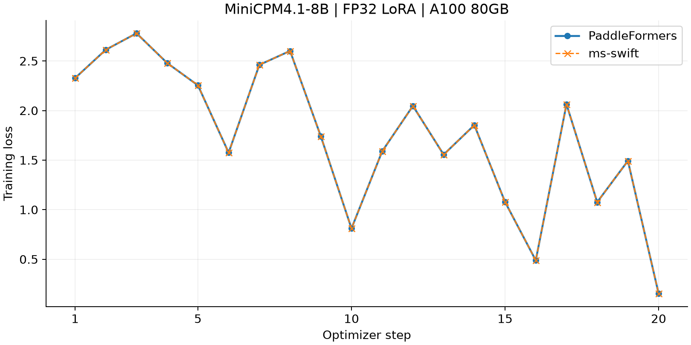
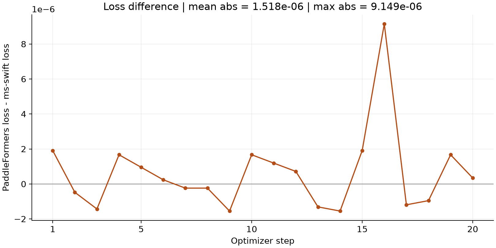

# MiniCPM4.1-8B FP32 alignment

Validated source: PaddleFormers PR #4840, commit `729cca11dc5663b00f67f91c62fb69724cf54c10`.
One NVIDIA A100-SXM4-80GB; both backends run sequentially on the same GPU.
See `environment-paddle.json` and `environment-swift.json` for package versions.

## Forward and generation

Both frameworks load the same four original Hugging Face safetensors shards from `openbmb/MiniCPM4.1-8B`; Paddle converts linear weight layout when loading. All model parameters and compute are FP32. AMP and TF32 are disabled. Both use eager attention.

Prompt: `The history of artificial intelligence began with the study of human reasoning. Today, researchers build language models that can understand and generate text. In the future,`.
The complete 31-token input IDs are recorded in `input.json`; the tokenizer assets and special-token settings are shared. Compare all 73,448 vocabulary logits at input positions 0..19 (not just the top token, and not log-softmax). `log_diff` is the mean elementwise absolute difference. The full inference arrays are stored in the inference NPZ files. This is a single-prompt check, not a broad benchmark.

- Mean absolute logits difference: 4.128514096e-06
- Maximum absolute logits difference: 6.580352783e-05
- Top-1 matches: 20/20
- Independent greedy generation with KV cache: 10/10 IDs equal = True
- Both generation calls explicitly use `eos_token_id=2` and request exactly 10 new tokens. No generated token is EOS. The Paddle generation API requires a scalar EOS when a minimum generation length is specified. The model and its weights are unchanged.
- Generated IDs: `[17251, 1982, 1441, 3374, 1385, 4702, 1384, 3122, 1358, 2809]`

## Official framework training

The training entry points are the repository's `python -m paddleformers.cli.launcher train paddle-training.yaml` and ms-swift's `swift sft`, not a custom optimizer loop. See the two `run-*-training.sh` scripts and `paddle-training.yaml` for all arguments.

- The same ten fixed instruction/response pairs in `paddle-dataset.jsonl` and `swift-dataset.jsonl`, no shuffling, 20 optimizer steps (two passes), batch size 1, gradient accumulation 1, max sequence length 512, no packing and no truncation in these samples.
- FP32, eager attention, no AMP/TF32, seed/data seed 23, no gradient checkpointing.
- AdamW: learning rate 1e-4, constant schedule, zero warmup/weight decay/gradient clipping; beta1=0.9, beta2=0.999, epsilon=1e-8.
- LoRA: r=8, alpha=16, dropout=0; q/k/v/o/gate/up/down projections in all 32 layers (224 modules; 22,151,168 trainable parameters), base weights frozen.
- PaddleFormers explicitly sets `compute_type: float32` and `amp_master_grad: false`.
- ms-swift explicitly disables `use_logits_to_keep`; both trainers compute the same full-sequence causal objective.
- Training template EOS is `73440` (PaddleFormers tokenizer/template setting); inference uses scalar EOS `2` as documented above.
- The custom ms-swift template mirrors PaddleFormers' default template exactly, including EOS/newline suffixes. This controlled template is used for framework alignment, not a claim about the recommended model chat template.
- `alignment_common.py` initializes the same LoRA A matrices from per-module NumPy seeds and transposes for backend layout; B is zero in both. Each module's canonical A hash and scaling are audited in the trace directories.
- `sitecustomize.py` / `swift-plugin.py` only synchronize initial adapter values and observe inputs, model dtypes, first logits and scalar losses. Each framework's original forward/loss, backward, AdamW update and learning-rate scheduler run normally; the observers delegate to the original functions.
- Every batch's input IDs, position IDs (explicit or model-default arange), and effective labels after causal shift are checked before computing training difference. Paddle batches can omit the final input token because their labels are already shifted; comparisons account only for that causal shift. Raw batches and initialization hashes are included in the trace directories.

| Metric | PaddleFormers | ms-swift |
|---|---:|---:|
| Step 1 loss | 2.3276445866 | 2.3276426792 |
| Step 20 loss | 0.1533974558 | 0.1533971131 |
| Mean loss over 20 steps | 1.7521549709 | 1.7521543473 |

Mean absolute stepwise loss difference: 1.517683268e-06; maximum: 9.149312973e-06. `losses.csv` contains every full-precision scalar; graphs plot those values without smoothing. `loss-diff.png` uses signed PaddleFormers minus ms-swift loss. Variation across samples means the loss curve need not decrease monotonically.





## Reproduce

Install the recorded package versions in separate Paddle and ms-swift environments, point the scripts to the same original model directory and this validation folder, then run:

```sh
bash run-inference.sh
bash run-paddle-training.sh
bash run-swift-training.sh
python analyze.py
```

Use empty trace/output directories for a new run: observers append scalar records. `analyze.py` validates inference input IDs, LoRA initialization and training batches before producing `summary.json`, `losses.csv` and both plots. The scope is one short prompt and one 20-step FP32 single-GPU SFT LoRA run; it does not establish long-context/sparse-attention or multi-GPU training accuracy.
