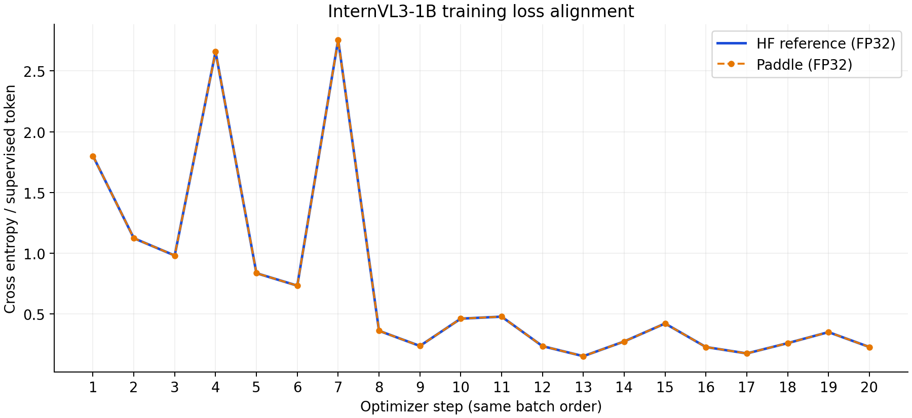
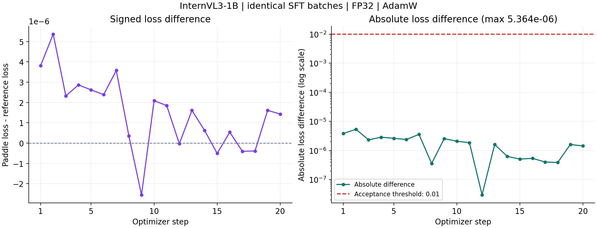

# InternVL3-1B numerical validation for PaddleFormers PR #4416

Recorded on 2026-11-24 (Asia/Shanghai). Tested implementation: `abaa61909ab2328500e5d4bde41a447c82c3ccdc`.

These are measured results, not expected values or smoothed curves. The two plots, raw per-step JSON/CSV, batch hashes, harnesses and logs are stored on a separate artifact branch so generated evidence does not enter the model code PR.

## Results

| Check | Measured value |
| --- | --- |
| FP32 mean absolute logit difference | 1.0307195383183743e-05 |
| FP32 maximum absolute logit difference | 0.00012826919555664062 |
| Top-1 agreement over the 20 compared input positions | 20/20 |
| Greedy new token IDs | 10/10 identical |
| Training optimizer steps per backend | 20 |
| Mean absolute training loss difference | 1.8462538719177247e-06 |
| Maximum absolute training loss difference | 5.364418029785156e-06 |
| Acceptance threshold | absolute difference < 0.01; all 20 steps pass |
| Model and processor tests, excluding GenerationD2S | 26 passed, 9 skipped |





## Environment and checkpoint

A100-SXM4-80GB; driver 525.60.11. Paddle uses Python 3.12.16 and paddlepaddle-gpu 3.4.0.post20260728+8a1040b3d08. The isolated reference uses Python 3.9.7, torch 2.0.0+cu117 and transformers 4.48.3. Torch is not required in the Paddle environment. See `environment-and-weights.json` for checkpoint SHA256 and exact hardware, and `checkpoint-config.json` for the original HF model configuration. Both frameworks load the SAME original local HF checkpoint from `/data/models/internvl3_1b` into FP32, not weights saved after training.

## Forward and generation protocol

The source example is `examples/image1.jpg` in that checkpoint. Question: `Please describe the image shortly.` Dynamic preprocessing creates 13 tiles (up to 12 plus thumbnail), each 448x448, with ImageNet normalization. The raw image-token prompt uses 256 IMG_CONTEXT tokens per tile. Shared NPZ arrays hold token IDs, normalized pixels, attention mask, position IDs and image flags. Both backends replay these same arrays. Model is in eval mode, FlashAttention disabled, TF32 disabled via `NVIDIA_TF32_OVERRIDE=0` (also both Torch TF32 flags false), prefill cache disabled.

The logit comparison is explicitly `logits[:, :20, :]`, shape `[1,20,151674]`, from a 3337-token INPUT prefill. These input positions include image placeholders. It is NOT a comparison of 20 generated answer tokens or all prompt positions. `log_diff = mean(abs(Paddle_logits - HF_logits))` across all compared positions and vocabulary; accumulation for the reported mean uses float64. The maximum is also reported independently.

Generation uses greedy decoding, no sampling, exactly 10 new tokens, cache enabled. Both output `[785,2168,4419,264,2518,88222,448,264,34847,62144]`, decoded as `The image features a red panda with a distinctive redd` (last word truncated at the 10-token limit).

The earlier BF16 run had mean absolute logit diff 0.1086723729968071 and max 1.6875, so it does NOT pass 0.01. It is retained in `bf16-prior-observation.json` for transparency. FP32 is the acceptance run; no claim is made that BF16 satisfies the same threshold.

## Training protocol

Export 20 real batches from the current PaddleFormers SFT dataset/dataloader/collator using `export-batches.py` and `export.yaml`. The fixture is the existing local 100-sample image QA dataset `examples/config/sft-vl/data/internvl3_sft_100/train.jsonl` (colored shape questions and PNGs). Each exported batch has one image, a single unpacked sequence of 321-329 tokens, and 8-16 supervised labels. Existing pre-shifted SFT labels and `-100` masks are preserved. The export script overrides the trainer entry point ONLY in its process to dump batches; it does not change any shared framework source files and does not optimize parameters. Learning-rate/warmup entries in `export.yaml` therefore do not describe the actual replay optimizer.

`train_alignment.py` loads identical original weights independently for Paddle and HF and performs 20 REAL forward/backward/AdamW steps on the exact same ordered exported arrays. Batch SHA256 is checked for every step. Both use FP32, seed 23, constant lr=1e-6, betas=(0.9,0.999), epsilon=1e-8, weight_decay=0, batch_size=1, gradient_accumulation=1, no clipping, no AMP or LR warmup, no FlashAttention/TF32/cache. All LM backbone parameters train; vision and projector are frozen and put in eval mode, matching the existing freeze_vision/freeze_aligner setup. LM attention dropout is 0. Every step checks finite loss and finite, nonzero LM-head gradient norm. The recorded loss is the scalar before that step's update. Curves are raw and unsmoothed; different question types explain spikes.

Paddle uses its model's own returned `loss`. The HF model is called without labels, then reference CE is applied directly to its logits and the SAME pre-shifted labels. This avoids HF's own additional label shift. Both losses ignore -100 and average over valid supervised tokens. This tests aligned optimization trajectories, not separate HF Trainer and Paddle Trainer data recipes or full convergence.

### Loss correction included in the model commit

In the tested Paddle development wheel, `cross_entropy(..., ignore_index=-100, reduction="mean")` averaged unreduced losses including zeros at ignored positions. On the first batch, Paddle's uncorrected 0.05048964 was HF's 1.8007935 times 9/321 (valid labels / sequence length). The InternVL model now explicitly sums unreduced CE and divides by `max(number_of_valid_labels,1)`. All-ignored batches return differentiable zero. It also keeps SFT labels pre-shifted, with no extra shift.

A regression test selects only valid logits/labels for its reference CE, so it can catch the normalization defect independently of ignore-index mean semantics. An additional test covers zero loss and zero output-head gradient for an all-ignored batch. No dataset, collator or trainer source was edited. Historical loss values obtained before this correction are not alignment evidence and are superseded by the 20-step results here.

## Inspect and rerun

- `training-alignment/loss-comparison.csv`: all 20 losses, signed/absolute differences, sequence lengths, supervised token counts, and batch SHA256.
- `training-alignment/{paddle,torch}-train.json`: settings, versions, losses and LM-head gradient norms.
- `training-alignment/plot_results.py`: regenerates CSV, summary and both plots using NumPy/Matplotlib, with no model rerun.
- `fp32/{paddle,torch}-results.json`, `fp32/summary.json`, and logs: inference/generation evidence.
- `training-alignment/tests.log` and `tests.xml`: test outcomes and skip reasons. GenerationD2S is excluded; this is not a claim that the full upstream test suite passed.

The recorded original harnesses retain server paths for traceability. On the same server, place `export-batches.py` and `export.yaml` in `/root/pr4416-validation/training-alignment/`, and run the exporter in the Paddle environment with arguments `train /root/pr4416-validation/training-alignment/export.yaml`. It creates `batches/000.npz` through `019.npz`. Run the training harness once in each environment:

```sh
export CUDA_VISIBLE_DEVICES=0 NVIDIA_TF32_OVERRIDE=0
export FLAGS_allow_tf32_cublas=0 FLAGS_allow_tf32_cudnn=0
export PATH=/home/vipuser/anaconda3/envs/paddleformers/bin:/usr/local/cuda/bin:$PATH
export LD_LIBRARY_PATH=/usr/local/cuda/lib64:${LD_LIBRARY_PATH:-}
export PADDLEFORMERS_ROOT=/root/baidu_98_internvl/PaddleFormers
export MODEL_PATH=/data/models/internvl3_1b
export VALIDATION_DIR=/root/pr4416-validation/training-alignment
python "$VALIDATION_DIR/train_alignment.py" paddle
/root/pr4416-validation/reference-env/bin/python "$VALIDATION_DIR/train_alignment.py" torch
python "$VALIDATION_DIR/plot_results.py"
```

The exporter requires the existing local dataset; the dataset, image binaries, full checkpoint, exported batches and large logit tensors are NOT bundled in this report. To reproduce elsewhere, provide that fixture or your own dataset and regenerate shared batches; new data will give different losses. The forward harness similarly requires the shared NPZ, which can be prepared with `compare_internvl3_logits.py:prepare_inputs` and saved with NumPy. Place the helper at the model repo's `examples/inference/compare_internvl3_logits.py` and the measured harness at `/root/pr4416-validation/measure-fp32.py`; `fp32/run-fp32.sh` records the exact launch flags.

```sh
python -m pytest -q tests/transformers/internvl3/test_processor.py tests/transformers/internvl3/test_modeling_internvl3.py -k 'not GenerationD2S'
```

## Scope

One image/prompt for forward/generation and a small 20-step QA training fixture validate local numerical migration behavior. This does not establish full-task convergence, benchmark quality, unrestricted generation support, vision/projector finetuning alignment, or BF16 numerical acceptance.
