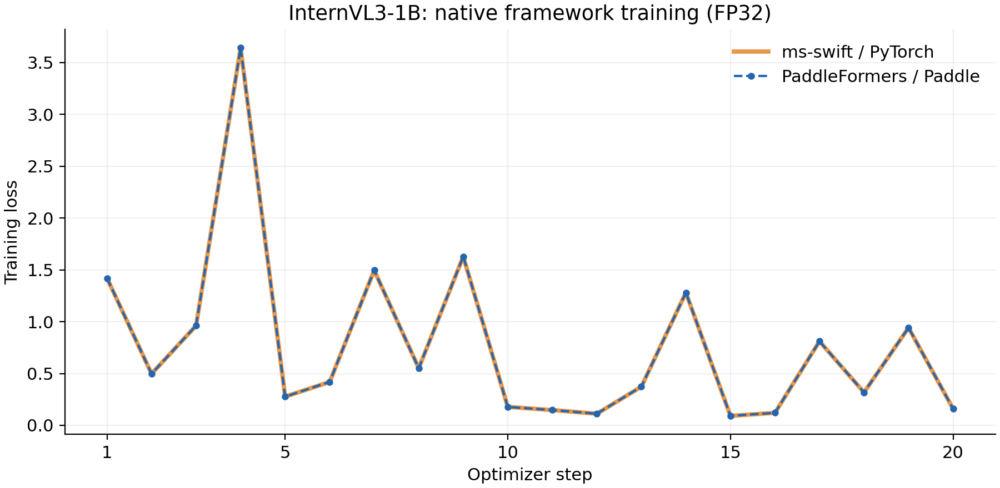
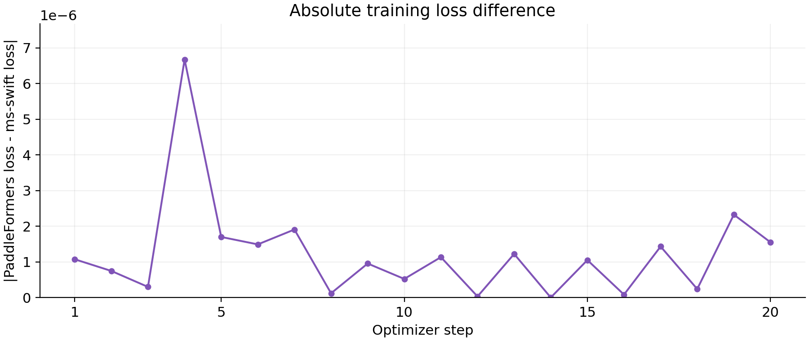

# InternVL3：完整框架训练对比

2026-11-24，在同一张 A100 80GB 上，以 PR 代码 `abaa61909ab2328500e5d4bde41a447c82c3ccdc` 和同一份 InternVL3-1B 初始权重，分别执行 PaddleFormers 和 ms-swift 的原生训练命令，各完成 20 个 optimizer step，退出码均为 0。

| 项目 | PaddleFormers / Paddle | ms-swift / PyTorch |
|---|---:|---:|
| 第 1 步 loss | 1.419382691 | 1.419383764 |
| 第 20 步 loss | 0.160194233 | 0.160195783 |
| 20 步平均 loss | 0.770933182 | 0.770933278 |
| 前 5 步平均 loss | 1.359168315 | 1.359169316 |
| 后 5 步平均 loss | 0.469981232 | 0.469981657 |

所有 loss 有限，没有 NaN/Inf。逐步 loss 的平均绝对差为 `1.2271e-6`，最大绝对差为 `6.6757e-6`。20 个 batch 的 token ID、规范到相同约定后的监督标签、图像像素均逐项完全相同，检查结果见 `batch-equivalence.json`。





训练条件：FP32，关闭 TF32、FlashAttention 和梯度重计算；batch size=1，梯度累积=1；AdamW，lr=`1e-6`，constant scheduler，betas=`(0.9,0.999)`，eps=`1e-8`，weight decay=0，不做梯度裁剪。冻结视觉编码器和投影层，训练完整语言模型，双方均有 629,697,920 个可训练参数。验证副本将视觉 `drop_path_rate` 从 0.1 设为 0，避免 train 模式随机深度造成随机差异；原始权重文件未修改。

PaddleFormers 使用 `paddleformers.cli.launcher train`，ms-swift 使用 `swift sft`，两边均由框架自带 Trainer 完成反向传播、优化器更新和调度。没有使用独立训练循环替代框架 Trainer。外部只读 observer 记录原始 batch 与原始 loss，调用原方法并原样返回结果；ms-swift 外部模板插件统一 system prompt、图片标记后的换行及结束符换行，不改模型损失函数。未修改公共数据处理、collator 或 Trainer 源码。

标签约定：PaddleFormers SFT 数据已经预移位；ms-swift 的 HF 模型在计算 loss 时内部移位。`audit-training.py` 仅在比较快照时规范化参考标签，不修改真实训练标签。

PaddleFormers 配置显式使用 `compute_type: float32` 和 `amp_master_grad: false`。仅设置 `bf16: false` 不足以覆盖该版本 CLI 默认的 `compute_type: bf16`。

本次为 20 步训练流程验证，能够说明两套完整训练流程正常运行且训练 loss 基本一致。各步使用不同样本，loss 会波动；前后 batch loss 的下降不能单独证明长期收敛或泛化效果。

## 环境与运行

- PaddleFormers 环境：`/home/vipuser/anaconda3/envs/paddleformers`
- ms-swift 独立环境：`/data/envs/ms-swift`，版本 3.4.1，Torch 2.0.0，Transformers 4.48.3；详细版本见 `framework-versions.json`。该 venv 复用已有 Torch，未将 Torch 安装到 PaddleFormers 环境。
- 服务器验证目录：`/root/pr4416-validation/framework-training`
- PaddleFormers 最终权重：`/data/internvl3-framework-validation/paddle-fp32-output`
- ms-swift 本次设置 `save_strategy=no`，不保存训练后权重；原生 Trainer 仍完整执行了 20 步训练。

```bash
bash /root/pr4416-validation/framework-training/run-paddle-fp32.sh
bash /root/pr4416-validation/framework-training/run-swift-full.sh
```

这些脚本使用服务器上现有的模型和 100 条颜色/形状问答测试数据。验证使用其中前 20 条，保持相同顺序且不 shuffle。数据集和依赖路径见配置。再次运行应使用新的输出与 trace 目录，避免旧快照或旧 loss 行混入。

证据：`paddle-fp32.log`、`swift-full.log` 为框架原始日志，`paddle-fp32-trace/losses.jsonl` 与 `swift-trace/losses.jsonl` 为逐步原始 loss，`framework-loss-comparison.csv` 为汇总，`framework-training-summary.json` 为统计，两个 `.exit` 文件为退出码。
